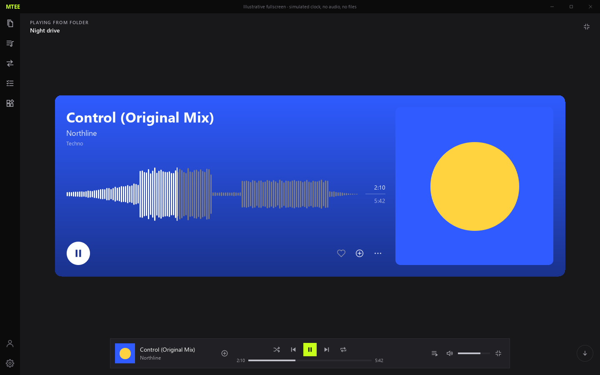
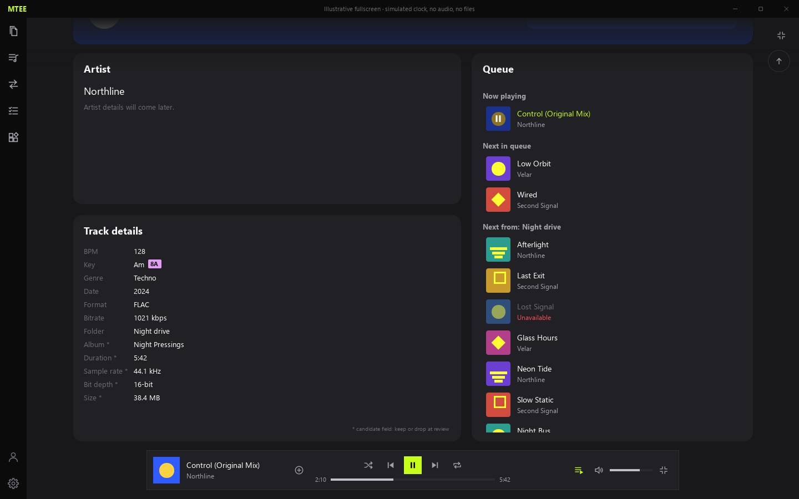

# Revue de maquette — Fullscreen player et waveform (plan 100)

Préparée le 1er octobre 2026. Cette maquette illustre les décisions S, C, W, G, P et D du plan `Plans d'exécution/100-plein-ecran-waveform.md`. Elle ne porte ni sur la logique de lecture réelle, ni sur l'analyse audio, ni sur le vocabulaire des tags. Toutes les valeurs numériques sont des valeurs initiales : le but de cette revue est de fixer les valeurs définitives.

## Parcours interactif

Depuis la racine du dépôt :

    uv run python scripts/review_fullscreen_100.py
    uv run python scripts/review_fullscreen_100.py --scene page2
    uv run python scripts/review_fullscreen_100.py --audio "<fichier audio local>" --covers "<dossier d'images local>"
    uv run python scripts/review_fullscreen_100.py --capture

Dans la fenêtre :

- molette, `PageDown` / `PageUp`, flèches haut et bas, flèches rondes à droite et bouton Queue de l'île : changent de page (transition animée, jamais d'état intermédiaire) ;
- molette au-dessus de la liste Queue : fait défiler la liste seulement, y compris en butée ;
- survol de la waveform : coloration et temps du haut, sans effet sur la lecture simulée ;
- clic sur la waveform, avec ou sans déplacement, puis relâchement dans la zone ou hors de la zone à gauche et à droite : le scrub est simulé sur l'horloge fictive, sans son. La ligne de titre de la fenêtre indique l'état (maintien, son coupé par un mouvement rapide, reprise, au-delà de la fin, passage au suivant au relâchement) ;
- cœur, `+`, `…` et les lignes de la file : menus et survols ;
- île : précédent/suivant changent de piste fictive (fondu de couleur d'environ 1 s) ;
- `F2` : panneau de réglage (largeur et écart des barres, hauteur de la waveform, hauteur supplémentaire de la carte, gamma, ombre, durée de transition, `fsPeek`, variante de Play, disposition de la page 2, état de la waveform, erreur de lecture, choix de piste). Il affiche les valeurs courantes pour pouvoir les recopier dans le Decision Log.

`--audio` décode un fichier local avec le décodeur du projet et calcule, dans le script, un prototype min/max/RMS : la première piste de la maquette prend ses barres de ce fichier. `--covers` extrait la couleur vive de quelques images d'un dossier avec un prototype de l'algorithme d'accent et ajoute une piste par image (le rendu d'une pochette réelle exige la fenêtre native, pas `--capture`). Aucun de ces fichiers n'est copié dans le dépôt ; les captures commitées n'utilisent que des données générées et `--capture` refuse ces deux options.

## Captures

Tailles de référence : 1440×900 et 880×600. Dossier : [fullscreen-100-2026-10-01](fullscreen-100-2026-10-01/).

| Capture | Ce qu'elle montre | Références |
|---|---|---|
| [page1](fullscreen-100-2026-10-01/page1-1440x900.png) | Page 1 : carte principale à pochette vive, dégradé d'accent, waveform, Play, cœur / + / …, pochette, île, flèche vers le bas, icône de sortie, « Playing from folder » | S1–S6, S10, C1–C5, C8, C10, C12–C15, C19, W1–W6, W12–W14, P3 |
| [page1-long-title](fullscreen-100-2026-10-01/page1-long-title-1440x900.png) | Titre trop long (le défilement du marquee est animé, la capture montre l'état de départ) et artistes multiples | C11, C12 |
| [page1-pale-cover](fullscreen-100-2026-10-01/page1-pale-cover-1440x900.png) | Pochette pâle (`#E8D77A`) assombrie automatiquement en `#756D3E` (contraste 5,25:1 avec le blanc) | C6 |
| [page1-no-cover](fullscreen-100-2026-10-01/page1-no-cover-1440x900.png) | Sans pochette et sans genre : gris de repli avec ombre, ligne du genre absente, `Unknown artist` | C3, C9, C13 |
| [page1-narrow](fullscreen-100-2026-10-01/page1-narrow-880x600.png) | Fenêtre étroite : pochette masquée, icônes au bord droit de la carte | C2, C14 |
| [page1-empty](fullscreen-100-2026-10-01/page1-empty-1440x900.png) | Aucune piste : texte `Play a track`, seule l'icône de sortie reste | S11 |
| [page1-generating](fullscreen-100-2026-10-01/page1-generating-1440x900.png) | Waveform en génération | C21 |
| [page1-error](fullscreen-100-2026-10-01/page1-error-1440x900.png) | Erreur de lecture dans la zone de la waveform | C21 |
| [waveform-variants](fullscreen-100-2026-10-01/waveform-variants-1440x900.png) | Barres A 2/1, B 3/2, C 4/2 × gamma 1,0 / 1,6 / 2,2 sur un signal fictif (intro, montée, drop, break, second drop 3 dB plus bas, outro) | W2, W5, W9 |
| [waveform-hover-ahead](fullscreen-100-2026-10-01/waveform-hover-ahead-1440x900.png) | Souris à droite de la tête de lecture : barres intermédiaires entre les deux, temps survolé en haut | W7, W8, W12 |
| [waveform-hover-behind](fullscreen-100-2026-10-01/waveform-hover-behind-1440x900.png) | Souris à gauche de la tête de lecture : blanc jusqu'à la souris, gris ensuite | W7 |
| [play-variants](fullscreen-100-2026-10-01/play-variants-1440x900.png) | Play A (blanc), B (noir), C (accent éclairci) sur pochette vive, pâle et grise | C20 |
| [page2](fullscreen-100-2026-10-01/page2-1440x900.png) | Page 2 large : Artiste (placeholder), Track details, Queue, bas de la carte principale sous la vignette, flèche vers le haut, bouton Queue de l'île actif | S7, P3, P4, D1–D5, D8, D9 |
| [page2-narrow](fullscreen-100-2026-10-01/page2-narrow-880x600.png) | Page 2 étroite : rangée Artiste + Track details, Queue dessous | D8 |
| [queue-hover-menu](fullscreen-100-2026-10-01/queue-hover-menu-1440x900.png) | Ligne survolée (voile et icône Play, bouton `…`) et menu de la ligne | D6, D7 |

## Points découverts en préparant la maquette

Ces points s'écartent d'une lecture littérale du plan ou nécessitent un avis. Ils sont inscrits dans `Surprises & Discoveries` du plan.

1. **Page 2 sous la carte.** Avec une colonne unique (carte puis page 2), les cartes de la page 2 seraient visibles sous la carte principale dès la page 1. La maquette fait glisser la page 2 depuis le bas de la vue pendant que la carte monte : les deux positions d'arrivée sont celles du plan (carte dépassant de `fsPeek`, cartes de la page 2 sous elle) et la page 2 est entièrement hors de vue en page 1. Pendant la transition, la carte et la page 2 ne se déplacent pas à la même vitesse.
2. **Ombre de repli.** À 5 %, une ombre noire sur `Theme.editor` (`#18181B`) est quasi imperceptible ; c'est le gris plus clair de la carte (`#26262B`) qui la détache. Le curseur `F2` va jusqu'à 50 % pour juger.
3. **Survol de la file.** `Theme.hover` (`#212125`) est identique au fond des cartes neutres (`Theme.surface`) : le survol y serait invisible. La maquette utilise `Theme.selection` (`#2A2A30`).
4. **Textes sur l'accent.** `Theme.textMuted` est illisible sur une carte colorée : la maquette utilise du blanc translucide pour l'artiste, le genre, les temps et les messages de la waveform.
5. **Play C sur la carte grise.** « Accent éclairci » donne un gris terne quand il n'y a pas d'accent ; A ou B sont plus lisibles dans ce cas.
6. **Largeur de l'île.** La flèche vers le bas se place à droite de l'île. En fenêtre étroite, la maquette réserve 76 px de chaque côté de l'île (largeur 680 px à 880 px de fenêtre) pour qu'elle ne la chevauche pas. Le contenu de l'île est inchangé mais plus serré qu'en mode normal.
7. **Track details.** Les champs candidats sont marqués d'un astérisque ; en fenêtre étroite la liste passe sur deux paires par ligne.
8. **Glisser-déposer de la file.** Il n'est pas redessiné ici : le geste est celui de la maquette du plan 99.

## Limites

Horloge simulée, aucun son, aucun fichier utilisateur, aucun service Python. Les captures hors écran vérifient le rendu QML et l'absence d'avertissement au chargement ; elles ne prouvent ni la qualité du geste sur une souris réelle, ni la latence du scrub, ni l'écoute. Le scrub est simulé avec les règles du plan (clic puis lecture, un repositionnement au plus toutes les 100 ms, coupure au-dessus de 2000 px/s, reprise après 80 ms de lenteur, blocage à gauche, état « au-delà de la fin » et passage au suivant au relâchement), mais ses seuils sont à régler à l'écoute au jalon 100.3. Les barres de la maquette sont calculées en JavaScript d'après des données fictives ; avec `--audio`, d'après l'énergie RMS d'un fichier réel. L'accent des pochettes est calculé par un prototype du script ; l'assombrissement (contraste 4,5:1 avec le blanc) est fait dans la maquette. Avec le rendu logiciel hors écran, les masques d'arrondi d'images réelles ne s'affichent pas ; la fenêtre native les affiche.

## Décisions attendues

Le développement fonctionnel de 100.1 à 100.7 attend ces décisions, conformément à `PLAN.md` et au jalon 100.0 du plan. Un silence n'est pas une validation.

1. **Variante de barres** : A (2/1), B (3/2) ou C (4/2) — ou valeurs libres.
2. **Gamma** : 1,0, 1,6, 2,2 ou autre valeur.
3. **Hauteur de la waveform** : 128 px proposé, et hauteur de la carte : 60 px ajoutés à la demande de l'utilisateur (curseur `Card extra height` de `F2`, plafonné pour que la carte ne touche pas l'île ; la pochette carrée grandit avec elle).
4. **Couleurs grises** : lecture `#7C7C82` et survol `#B9B9BF` proposés.
5. **Variante de Play** : A (blanc), B (noir) ou C (accent éclairci).
6. **Ombre du repli** : intensité (5 % proposé) et son aspect.
7. **Champs de Track details** : parmi `Album`, `Duration`, `Sample rate`, `Bit depth`, `Size`, lesquels garder en plus de `BPM`, `Key`, `Genre`, `Date`, `Format`, `Bitrate`, `Folder`.
8. **Disposition de la page 2** : large (Artiste et Track details à gauche, Queue à droite) et étroite proposées ; seuil, proportions et empilement.
9. **Marquee** : vitesse (40 px/s) et pauses (2 s) proposées.
10. **Placeholder Artiste** : le texte `Artist details will come later.` convient-il ?
11. **Tailles de textes** : titre 34, artiste 18, genre 13.

À ratifier aussi : les points 1 à 6 de la section précédente.
