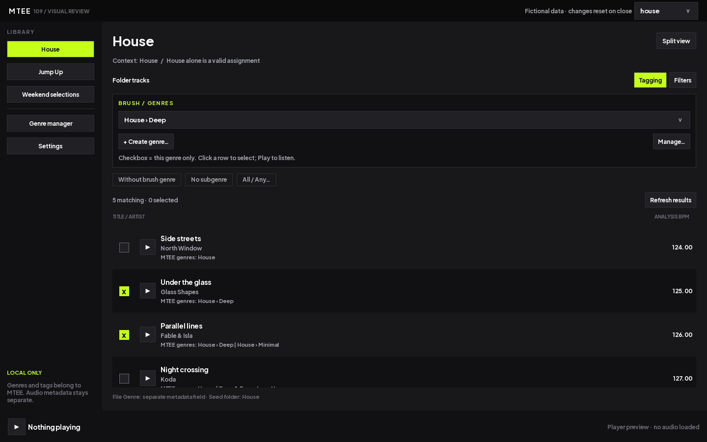
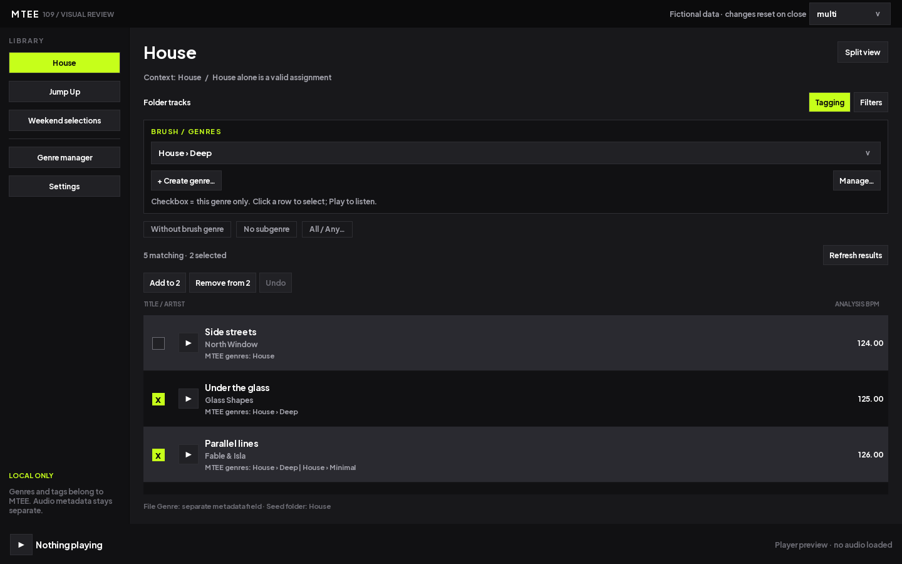
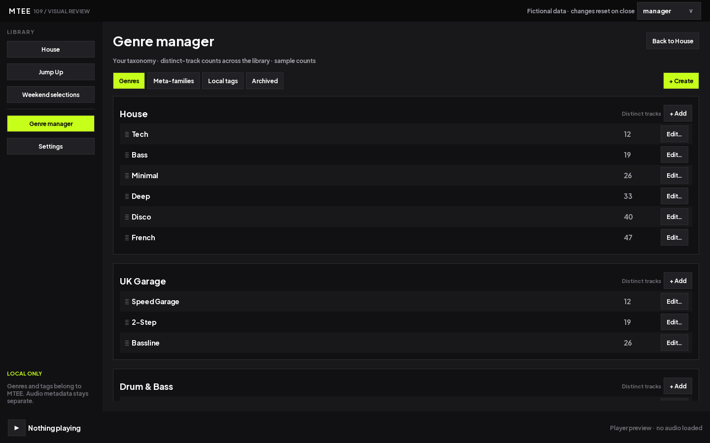
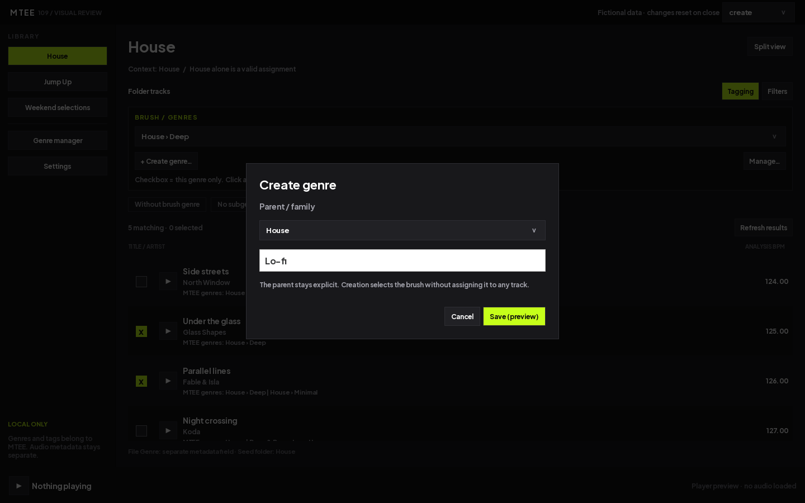
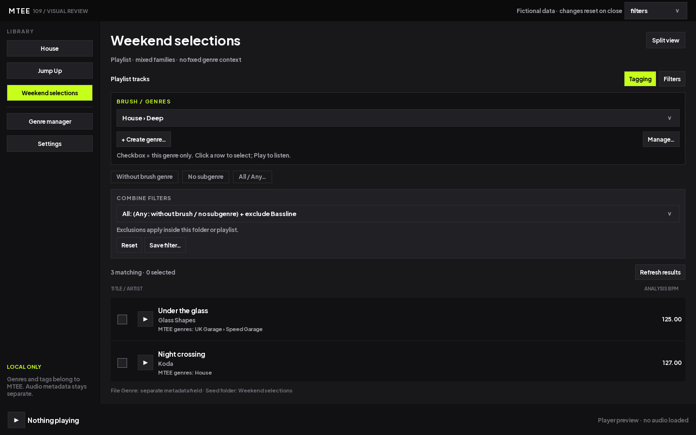
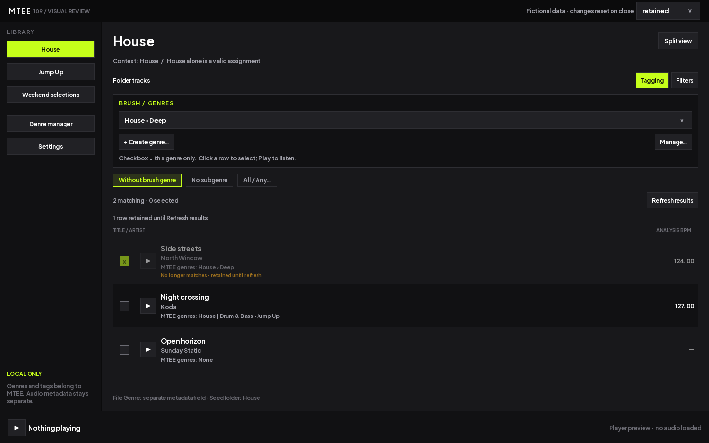
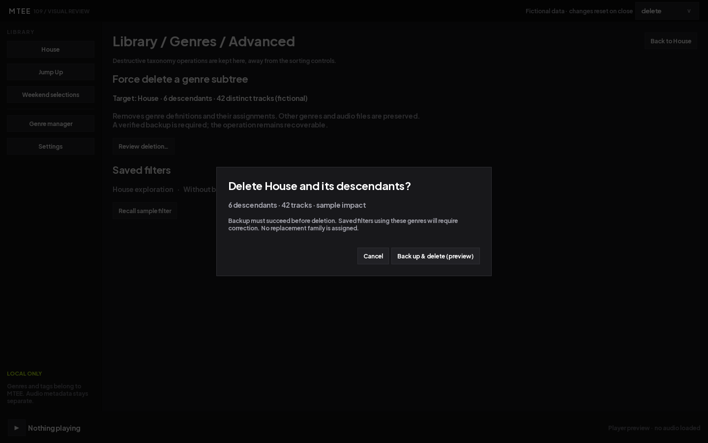
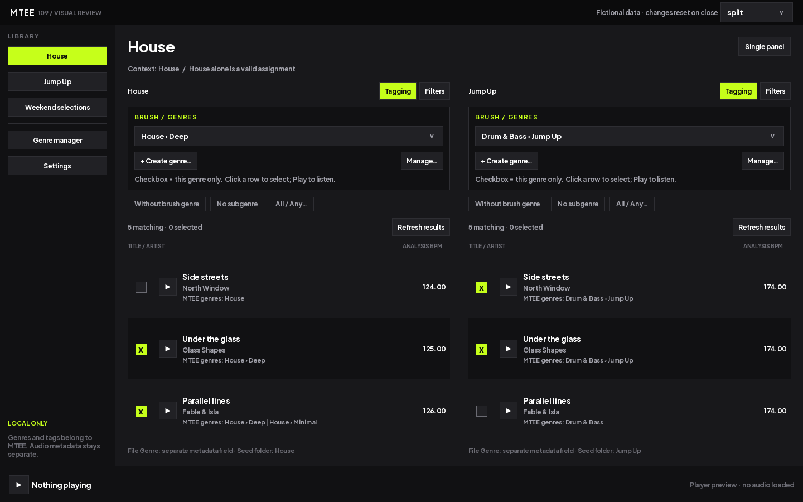
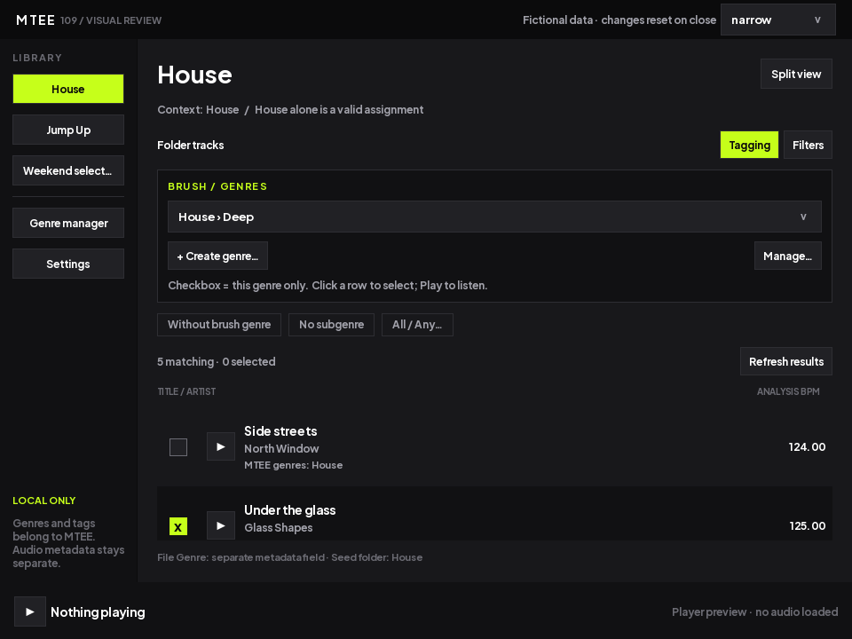

# Revue 109 — Genres des morceaux

Maquettes QML préparées le 7 octobre 2026 pour le prérequis 109.0. Elles utilisent uniquement des morceaux fictifs en mémoire. **Revue utilisateur en attente** : aucune migration, affectation réelle ni suppression d'ancien genre artiste effectuée.

## Ouvrir la revue

Depuis la racine du dépôt :

    uv run python scripts/review_genres_109.py

Le sélecteur en haut à droite change de scénario. La sidebar ouvre House, Jump Up, une playlist mélangée, le manager et les paramètres. Les actions modifient uniquement le prototype ; fermer la fenêtre réinitialise les choix. Play modifie le libellé du lecteur fictif sans charger d'audio.

## Proposition à examiner

La liste conserve son fonctionnement visuel habituel et ajoute une barre `Tagging`. Le pinceau est un genre au chemin explicite ; sa case par morceau représente exclusivement ce genre. La sélection ordinaire reste indépendante et permet les lots. Les affectations sont résumées en texte, sans rangée de puces interactives. `MTEE genres` est distinct du champ Genre du fichier ; le BPM présenté est celui d'analyse, avec une valeur absente visible.

Cliquer une ligne sélectionne ; Ctrl ajoute ou retire une ligne, Maj étend la sélection. Cocher affecte le pinceau sans lecture. Ajouter Deep à House conserve la famille implicite ; retirer le dernier sous-genre ramène à House dans la simulation. Les commandes de lot annoncent le nombre de cibles. `Undo` et Ctrl+Z depuis la liste annulent le lot en mémoire.

Le manager présente des tables par famille, leurs enfants et des compteurs fictifs annoncés comme distincts. Il possède des sections séparées pour méta-familles, tags locaux et archives. La fenêtre Edit montre nom, parent, alias, déplacement, archivage et refus de suppression d'un genre utilisé. La création rapide affiche explicitement le parent puis sélectionne le nouveau pinceau sans affecter les lignes.

Les filtres rapides `Without brush genre` et `No subgenre` côtoient le panneau `All / Any`. La maquette illustre intersection, union et `(Without brush OR No subgenre) AND Exclude Bassline`. Jump Up affiche son contexte Drum & Bass et explique que l'exclusion de cette famille est indisponible. Une playlist mélangée n'impose pas ce contexte.

Une écriture de genre qui fait sortir un morceau du filtre conserve sa ligne grisée et corrige son compteur. `Refresh results` retire explicitement cette ligne. Annuler restaure la correspondance. Les scénarios Saving et erreur montrent les messages et la relance.

La suppression forcée se trouve uniquement dans `Settings > Library > Genres > Advanced`. La confirmation indique la cible, les descendants, les morceaux, la sauvegarde préalable et l'invalidation des filtres. Le bouton est explicitement marqué preview et n'effectue aucune suppression.

## Scénarios disponibles

| Scénario | Point de revue |
|---|---|
| seed | Résultat minimal du lot 1, affectations locales en lecture seule |
| house | House seul, Deep, Deep + Minimal, hybride inter-familles, sans genre |
| jump-up | Contexte Drum & Bass, pinceau Jump Up |
| mixed | Playlist Speed Garage, Bassline, hybride et familles simples |
| manager / meta / tags | Tables de genres, méta-familles, tags locaux |
| filters | ET, OU et exclusion combinés |
| retained | Ligne conservée après sortie du filtre |
| saving / error | Écriture en cours et échec avec relance |
| create / delete | Création rapide et confirmation de suppression forcée |
| multi | Deux morceaux sélectionnés et commandes de lot |
| split / narrow | Deux panneaux et fenêtre 960 × 720 |

## Limites et reprise

Le prototype sert à valider la disposition et les interactions centrales. Les listes déroulantes de filtres proposent des exemples fixes, pas encore un éditeur générique d'expressions. L'enregistrement des filtres, les opérations complètes du manager (dont déplacement par glisser-déposer), les UUID, la persistance, les sauvegardes et les conflits sont à développer dans les jalons suivants. Les tags et méta-familles du manager illustrent les tables ; leurs dialogues spécialisés restent à brancher. Le prototype n'est pas intégré à la fenêtre de production, ne joue pas de fichiers et ne démontre pas les performances de la collection réelle.

Les 16 scènes ont été capturées hors écran, sans avertissement QML. Les captures ont été examinées par l'agent ; cela ne constitue ni une recette interactive de MTEE ni une validation utilisateur. La revue porte sur la barre de pinceau, la représentation des affectations, les tables du manager, les filtres, les états retenus et les dispositions compactes. Après accord ou ajustements demandés, consigner cette réponse dans le plan puis reprendre 109.1. Le tableau réel de 109.2 devra faire l'objet de sa propre vérification avant application.
