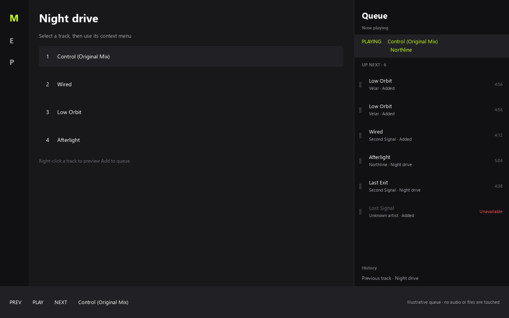
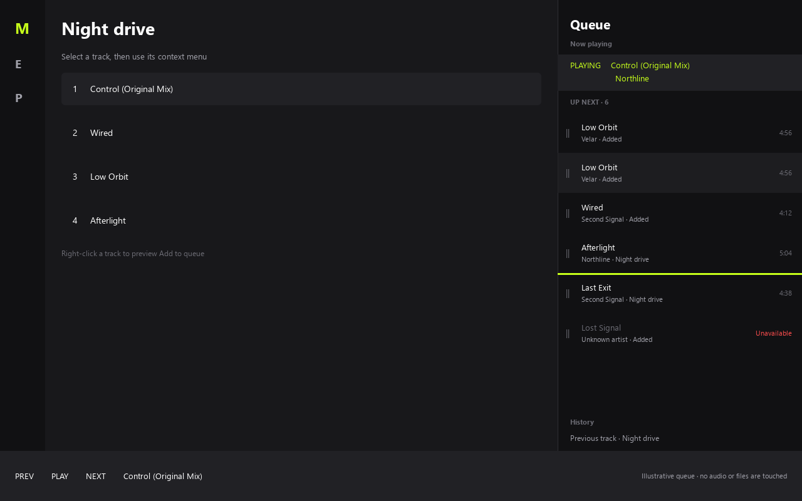

# Revue de maquette — file de lecture du plan 99

Préparée le 1er octobre 2026. Cette maquette montre uniquement les nouvelles commandes visuelles de la feature 9. Les décisions Q1–Q4 du plan 99 restent acquises ; cette revue ne porte ni sur la logique de lecture, ni sur la navigation, ni sur le vocabulaire des tags.

## À examiner

1. `Add to queue` figure dans le menu contextuel d'une piste. La sélection multiple utilisera le même libellé et l'ordre visible de la liste. Le menu d'une playlist entière recevra aussi cette action.
2. `Remove from queue` figure dans le menu contextuel d'une occurrence à venir. Deux lignes « Low Orbit » représentent deux occurrences différentes : retirer l'une conserve l'autre.
3. Le déplacement se fait en tenant une ligne de la file, avec surbrillance de la ligne prise et trait vert à la position d'insertion. L'ordre ne change qu'au relâchement. Escape annule. Le courant et History restent hors des cibles.
4. Une entrée indisponible reste visible et peut être retirée. L'état vide n'offre aucune commande de vidage global.

La file est montrée dans le panneau Queue existant et dans une largeur élargie représentative du plein écran. Le prototype conserve le double-clic sur une ligne et le défilement de la liste. L'implémentation reliera ces gestes aux occurrences réelles après validation.

## Captures

| Vue | Capture |
|---|---|
| Panneau et doublons | [panel-1280x800.png](queue-99-2026-10-01/panel-1280x800.png) |
| Emplacement élargi | [fullscreen-1440x900.png](queue-99-2026-10-01/fullscreen-1440x900.png) |
| Menu de piste | [track-menu-1280x800.png](queue-99-2026-10-01/track-menu-1280x800.png) |
| Menu d'occurrence | [queue-menu-1280x800.png](queue-99-2026-10-01/queue-menu-1280x800.png) |
| Drag avant relâchement | [drag-1280x800.png](queue-99-2026-10-01/drag-1280x800.png) |
| File vide | [empty-1280x800.png](queue-99-2026-10-01/empty-1280x800.png) |

## Parcours interactif

Depuis la racine du dépôt :

    uv run python scripts/review_queue_99.py

Clic droit sur une piste à gauche pour voir `Add to queue`, puis clic droit sur une ligne à venir pour voir `Remove from queue`. Tirer une ligne à venir vers une autre position et relâcher pour changer l'ordre de la maquette. Lancer directement `--scene empty` pour l'état vide ou `--scene fullscreen` pour l'emplacement élargi. `--capture` régénère les six captures avec des données fictives.

## Limites et décision attendue

Les actions de la maquette modifient uniquement un tableau QML en mémoire. Aucun service audio, fichier, playlist, base de données ou état de l'application réelle n'est sollicité. Les captures hors écran vérifient le rendu QML et l'absence d'avertissement au chargement ; elles ne prouvent pas la qualité du geste sur une souris réelle, l'écoute, la persistance ou le comportement du backend.

**Décision attendue :** validation ou corrections visuelles précises des menus et du geste de réordonnancement. Le développement fonctionnel de 99.1 à 99.8 attend cette validation, conformément à `PLAN.md` et au jalon 99.0.
