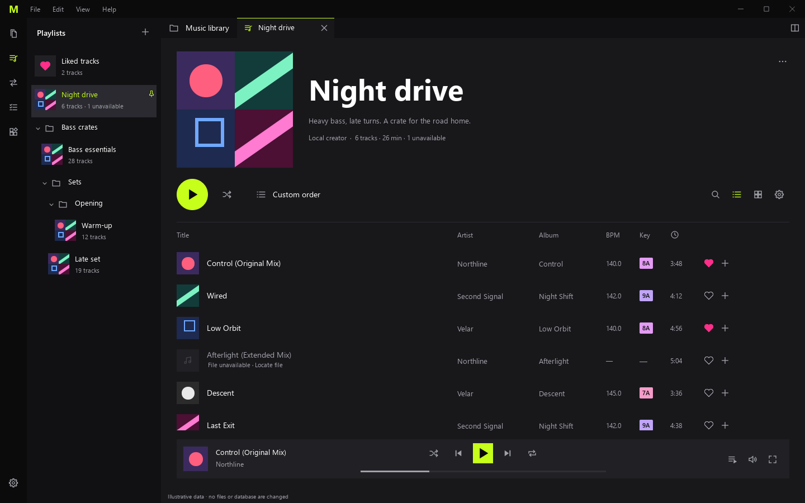
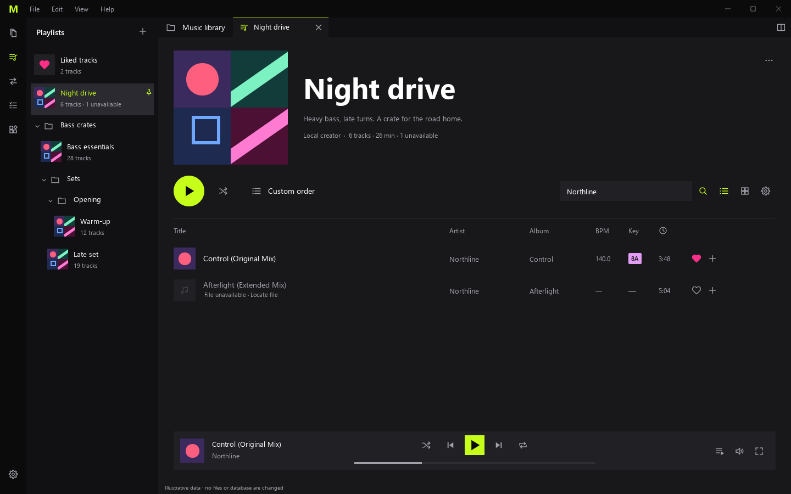
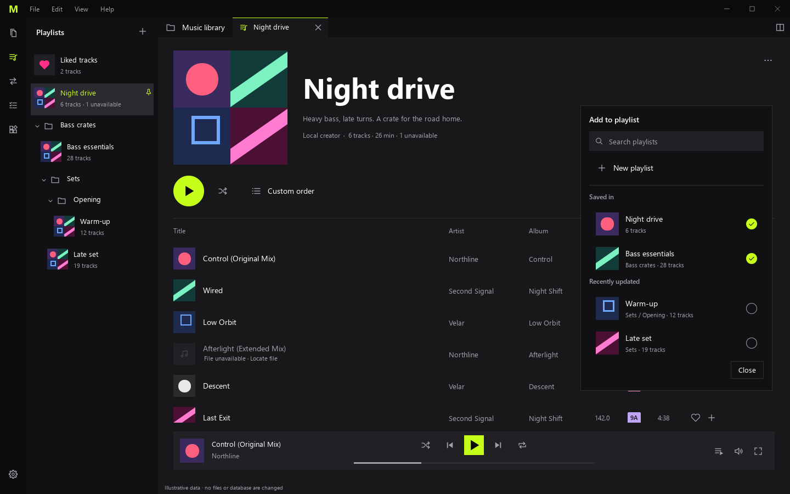
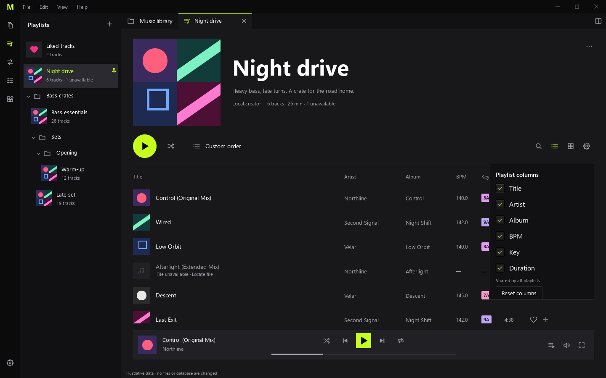
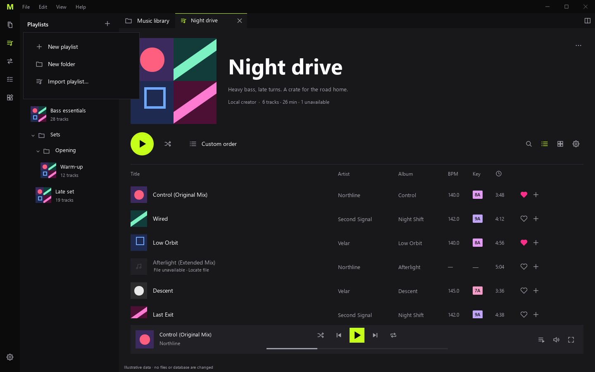
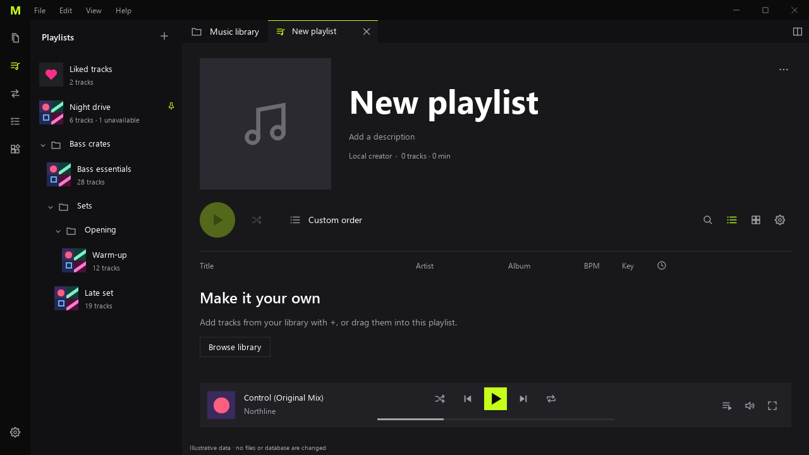
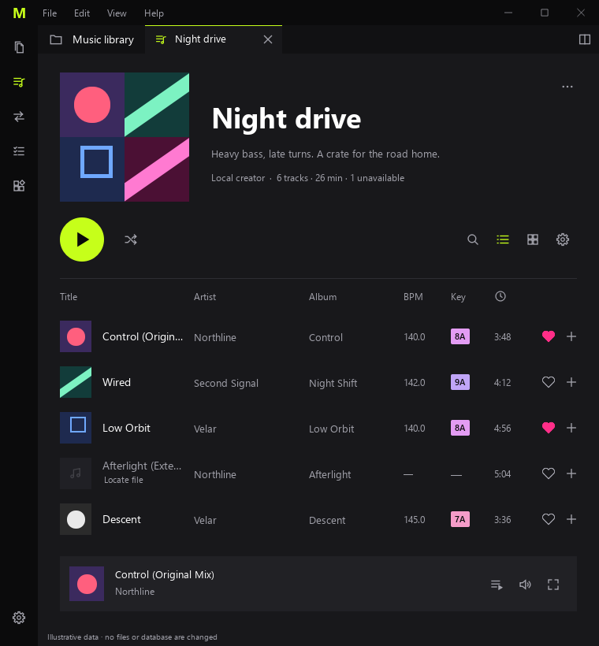
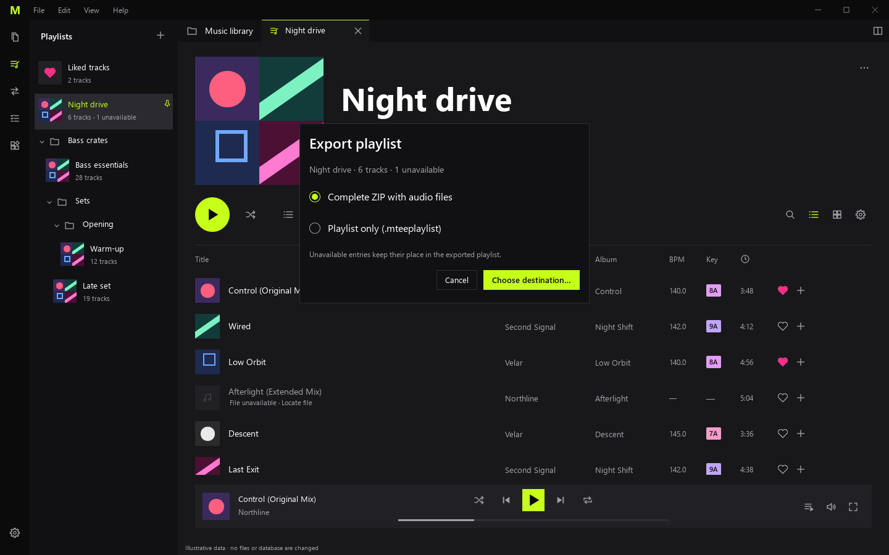
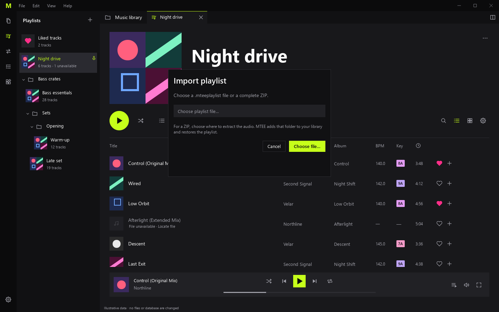
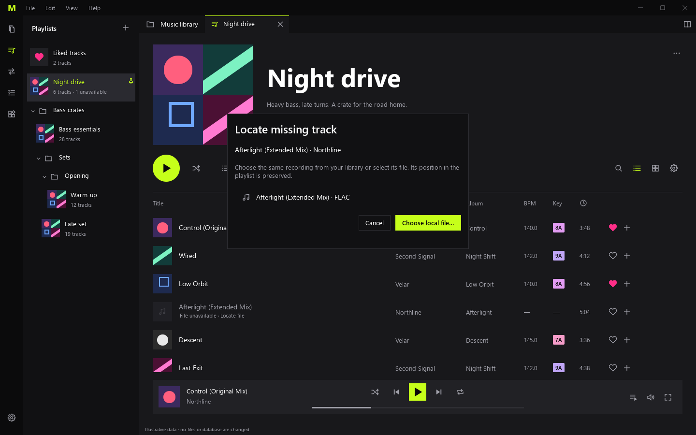

# Revue 34.1 — Playlists locales

Préparée le 2026-09-30 ; **validation utilisateur en attente**. La référence est la composition annotée et le menu fournis dans la conversation, avec les décisions de `../decisions/34-playlists.md`. Les données ci-dessous sont inventées ; pochettes et noms ne viennent pas de la collection personnelle. L'interface est anglaise et reprend Theme, les icônes et composants de MTEE.

## Page et recherche

La pochette de 208 px occupe la gauche, le titre de 52 px et la description la droite. Le créateur commun, le total, la durée connue et le nombre d'absences se placent sous la description. Play/Shuffle sont sous la pochette. Search, List, Artwork et Choose columns ont la même taille d'icônes et sont centrés sur la rangée du bouton Play. La séparation au-dessus du tableau est grise comme les autres séparations de MTEE ; les couleurs de l'annotation servent de repères, pas de nouvelles couleurs à implémenter.

Search révèle le champ vers la gauche en 190 ms. Replier le champ conserve texte et résultats ; l'icône reste active pour signaler le filtre. La recherche illustrative Northline montre un morceau disponible et un manquant. Play ne prend que le disponible. L'implémentation réelle conservera l'instantané de lecture existant.

## Menu d'ajout et colonnes

Le menu reprend la capture utilisateur avec recherche, New playlist, Saved in, Recently updated, pochettes, compteurs et chemins de dossiers. Chaque clic applique l'ajout/retrait immédiatement et le menu reste ouvert. Close ou Échap ferment sans annuler les clics précédents. Le cœur séparé gère uniquement les likes MTEE. Les lignes grisées comportent Locate file et restent à leur position.

Le profil commun aux playlists présente Title, Artist, Album, BPM, Key et Duration ; aucune taille, format, date ou bitrate. Le profil des dossiers audio reste indépendant. Dans ce prototype, les coches du sélecteur sont des témoins visuels et ne reconfigurent pas encore le tableau.

## Sidebar, vide et largeur réduite

Proposition de présentation : Liked tracks en tête, puis épingles et arbre à ordre manuel, avec dossiers imbriqués. Le menu de création contient New playlist, New folder et Import playlist ; aucun parcours Spotify. Le nom de créateur est volontairement générique dans les fixtures. Le nom partagé sera modifiable dans General de Settings lors de l'implémentation.

La pochette passe à 164 px et la sidebar est repliée à petite largeur. Le tableau se parcourt horizontalement si toutes ses colonnes ne tiennent pas. Le défilement vertical réserve l'espace de l'îlot. Proposition de présentation : le résumé montre le total des entrées et la durée connue, avec compteur d'indisponibles ; les filtres changent la lecture, pas ces totaux.

Les [likes](playlists-2026-09-30/liked-1440x900.png) et la [vue Artwork](playlists-2026-09-30/artwork-1440x900.png) possèdent aussi une capture. Liked tracks est proposé comme vue système non supprimable et initialement ordonnée par date de like ; les tris restent temporaires. Une couverture locale remplacera la mosaïque ; aucune image réelle n'est nécessaire à la revue.

## Échanges et localisation

Les échanges sont des panneaux de revue, sans choix de fichier ni écriture. Le ZIP garde les entrées indisponibles dans son manifeste et annonce l'audio absent. Le parcours réel choisira une destination, extraira dans un dossier neuf sans écrasement, ajoutera la bibliothèque et proposera les ambiguïtés avant de recréer la playlist. Locate file conserve l'entrée et sa position.

## Examiner le prototype

Depuis la racine du dépôt :

    uv run python docs/ux/mockups/review_playlists.py
    uv run python docs/ux/mockups/review_playlists.py --scene menu
    uv run python docs/ux/mockups/review_playlists.py --scene export

Le lanceur ouvre une fenêtre QML sans base ni accès à la collection. Search, Play fictif, menu d'appartenance, cœur, vue Artwork et quelques commandes de présentation sont interactifs. Les scans, la persistance, les drag-and-drop, l'édition réelle, les dialogues natifs de fichiers et les exports sont réservés au backend et aux vues de 34.2–34.4. Le prototype n'est pas une recette de l'application.

## Décision de revue attendue

Valider ou corriger la composition, la taille de la pochette et du titre, la rangée d'actions, le menu à coches, la sidebar et les propositions de totaux/Liked tracks. Une réponse peut cibler un ajustement précis ; ne pas refaire le cadrage confirmé. Après accord explicite, mettre à jour le statut, l'ExecPlan et la spécification, puis poursuivre l'implémentation fonctionnelle autorisée. Aucun accord ni test backend n'est attribué à l'utilisateur avant cette réponse.
