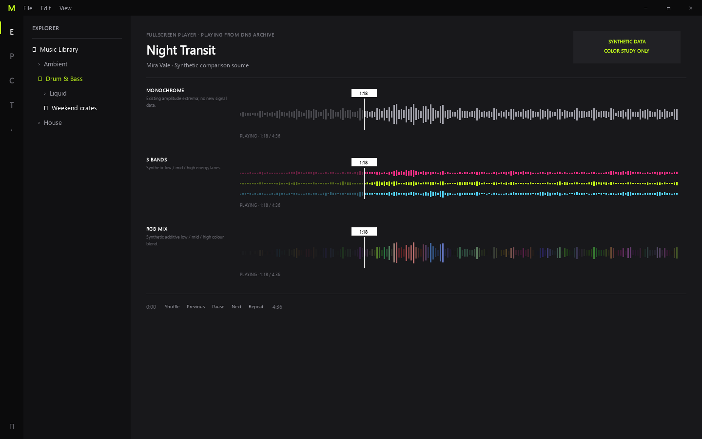

# Revue des plans UX/UI 26 à 28

**Statut : décisions utilisateur confirmées le 29 septembre 2026.** Les images restent une planche QML statique, fondée sur `docs/ux/specification.md`. Elles ne modifient ni l’interface livrée ni ses données. Les écrans non retenus sont conservés comme historique de revue ; seules les décisions ci-dessous guident le code. Régénérer avec `uv run python docs/ux/mockups/render_review.py` depuis la racine ; le rendu utilise Qt Quick en mode logiciel et n’ouvre aucune collection.

## Plan 26 — En-tête de dossier

La proposition statique qui alignait la recherche et les commandes List, Artwork et Choose columns sur une même rangée est refusée. L’image fournie par l’utilisateur sert de référence : le champ garde son apparence, son libellé et sa place en haut à droite ; le nom et son résumé restent à gauche ; les commandes restent groupées en bas à droite. Le code existant présente déjà cette disposition.

À 1440 × 900, l’éditeur fait 852 px entre la barre latérale et le panneau Info : [recherche vide](review-ux-ui-2026-09/header-wide-1440x900.png). À 1280 × 720, il fait 712 px avec le champ rempli : [recherche filtrée](review-ux-ui-2026-09/header-medium-1280x720.png). Le cas partagé montre deux groupes de 415 px dans une fenêtre de 1100 px : [groupes divisés](review-ux-ui-2026-09/header-split-1100x760.png).

Le texte et les résultats filtrés restent conservés selon la décision déjà consignée. Le focus et le défilement sont implémentés sans changer l’apparence du champ ni déplacer les commandes.

## Plan 27 — Colonnes, pochettes et commandes de ligne

Le menu présenté dans la planche est retenu. La rangée d’en-têtes des colonnes conserve son apparence et son emplacement actuels, comme sur la capture de référence de l’utilisateur ; les contrôles d’en-tête du dossier ne changent pas. Le tableau par défaut présente `Title | Artist | Date created | BPM | Key`, les pochettes restent visibles par défaut, et la personnalisation reste globale. Le numéro ordinal n’est pas une colonne configurable. Une piste sélectionnée et en lecture reste indiquée par fond de sélection, chevron lime et titre lime quand celui-ci est visible.

- [Menu complet et colonnes par défaut](review-ux-ui-2026-09/columns-menu-1440x900.png)
- [Beaucoup de colonnes](review-ux-ui-2026-09/columns-many-1600x900.png)
- [Title et pochettes masqués](review-ux-ui-2026-09/columns-reduced-1440x900.png)
- [Une seule colonne, avec le menu encore accessible](review-ux-ui-2026-09/columns-single-1280x720.png)
- [Menu dans un groupe partagé de 415 px](review-ux-ui-2026-09/columns-split-1100x760.png)

Les commandes de ligne restent utilisables même si Title ou les pochettes sont masqués ; le numéro de piste enregistré dans les tags reste inchangé. La présentation de la rangée d’en-têtes n’est pas remplacée par celle des captures de comparaison.

## Plan 28 — Comparaison de waveforms

### Diagnostic du rendu existant

Le calcul actuel produit du PCM stéréo 22 050 Hz, agrégé par fenêtres de 20 ms en extrema min/max. Il conserve une pyramide de réduction et la vue choisit un niveau d’au plus 1 200 points. Le modèle fusionne les extrema des canaux pour son aperçu. `WaveformView.qml` dessine un trait vertical par point, avec une largeur minimale de 1 px ; chaque changement de données ou de position demande actuellement un repaint du Canvas. Les données et le cache ne comportent ni énergie RMS, ni valeur grave/médium/aigu. Les extrema seuls ne permettent donc pas de fabriquer des bandes de fréquences réelles.

Cette inspection du code ne remplace pas le diagnostic sur un corpus audio : aucun morceau utilisateur, signal synthétique décodé par le service, mesure de performance ou gain de lisibilité n’a été observé. Le signal des maquettes est généré directement dans QML et représente une intro calme, des passages plus denses et un creux. Les niveaux de bandes sont eux aussi synthétiques. Les captures ne prétendent pas représenter l’analyse d’un fichier.

### Les variantes proposées

La comparaison statique conserve le même morceau synthétique, la même taille de vue (1440 × 900), la même durée (4:36) et la même position courante (1:18, environ 28,3 %). Elle reste un historique de conception, pas une demande de livrer trois modes.

La grille montre chaque variante au début, à 1:18 et à la fin ; la capture d’états illustre le curseur à 0 et à la fin, la pause à mi-parcours ainsi que les états Preparing et Unavailable. La vue étroite mesure 508 px de large.

- [Chaque variante au début, au milieu et à la fin](review-ux-ui-2026-09/wave-positions-1440x900.png)
- [Pause, extrémités et états indisponibles](review-ux-ui-2026-09/wave-edges-1280x900.png)
- [Vue étroite de 508 px](review-ux-ui-2026-09/wave-narrow-620x900.png)

| Choix | Avantage proposé | Coût et limite |
|---|---|---|
| Monochrome | Réutilise le cache min/max existant et reste dans la palette actuelle. | La géométrie doit suffire à distinguer les passages ; la capture seule ne prouve pas une amélioration. |
| 3 bandes | Sépare visuellement trois zones de fréquences. | Exige un vrai calcul audio hors thread UI et une version de cache dédiée ; le cyan montré est un accent supplémentaire proposé. |
| RGB | Résume les trois niveaux par une couleur composite. | Exige les mêmes calculs et une règle de mélange stable ; les teintes colorées s’éloignent de la palette Acid et peuvent être moins lisibles. |

L’utilisateur retient uniquement le rendu monochrome montré dans les captures. Il indique que les trois bandes ne répondent pas au besoin ; le calcul fréquentiel et RGB ne sont donc pas implémentés. Le repère temporel, le contraste de la tête de lecture, l’assombrissement de la portion lue et le seek restent dans le périmètre.

Le zoom, la boucle A/B et les cues restent hors périmètre.

## Réponse attendue

Les plans 26, 27 et 28 s’enchaînent dans cet ordre. La compilation de l’EXE est prévue à la fin de chaque jalon applicatif.
