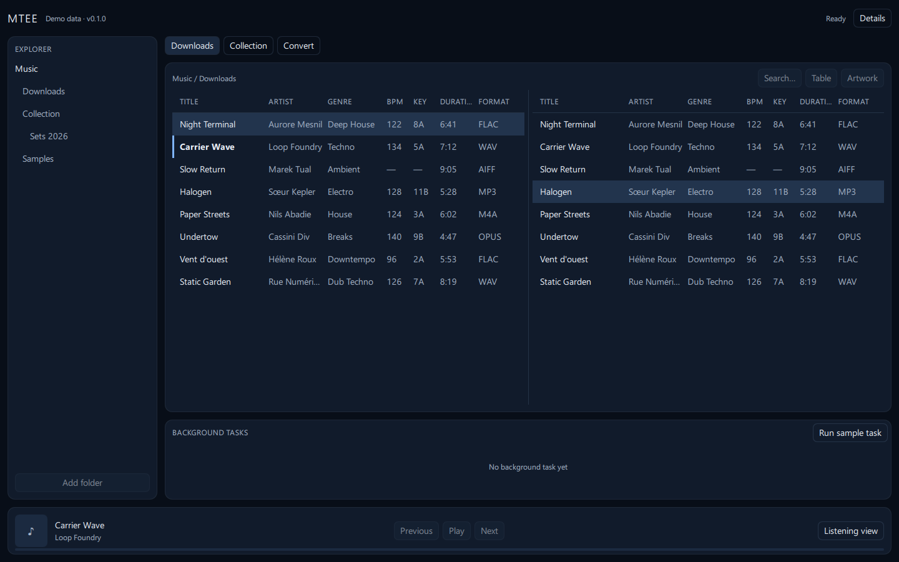
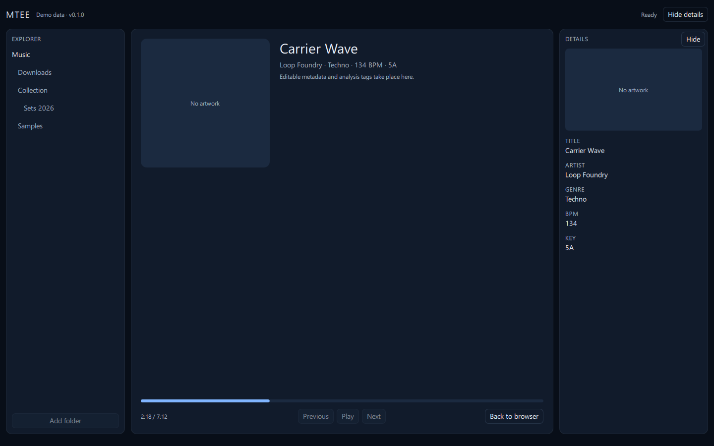
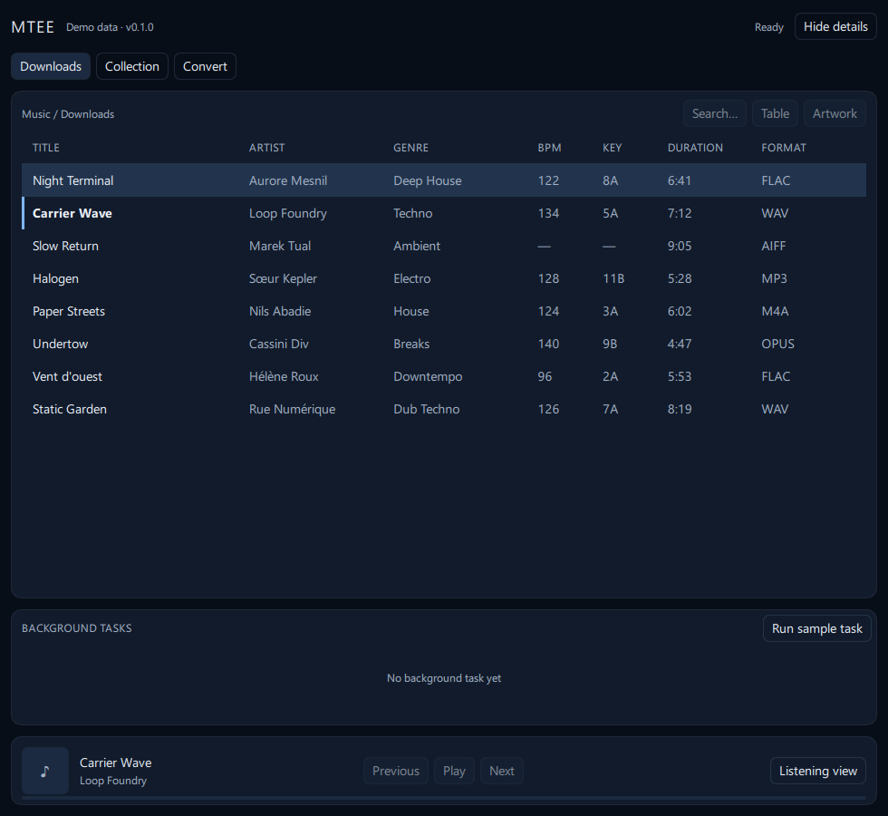
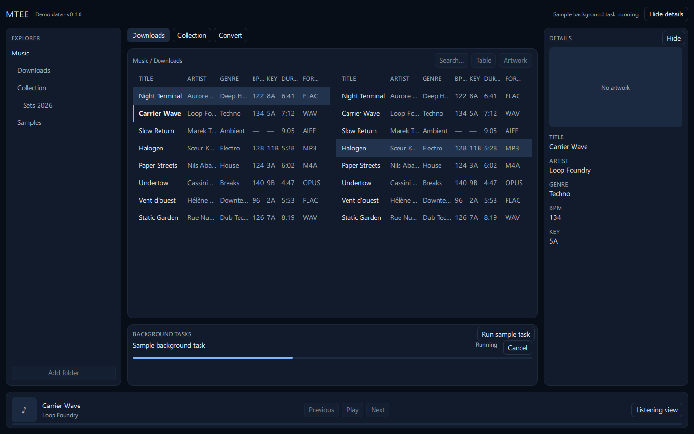

# Recette du plan 01 — socle desktop et distribution Windows

Compte rendu des contrôles réellement exécutés le 10 septembre 2026. Les constats non observés sont indiqués comme tels ; aucune validation n'est déduite d'une autre.

## Environnement de recette

Windows 11 Professionnel 10.0.26200, architecture AMD64, poste de développement. Python 3.12.14 installé par `uv python install 3.12`, uv 0.12.12 obtenu par `python -m pip install --user uv` faute d'installation préalable sur la machine. Les versions verrouillées sont détaillées dans `docs/architecture/dependencies.md`.

L'exécutable `uv.exe` réside dans `%APPDATA%\Python\Python314\Scripts`, répertoire absent du `PATH` : chaque commande de cette recette a été lancée avec ce répertoire ajouté au `PATH` de la session. Ajouter ce chemin au `PATH` de l'utilisateur reste à faire pour un usage courant.

## Commandes exécutées et résultats

| Commande | Résultat |
|---|---|
| `uv python install 3.12` | Python 3.12.14 téléchargé ; message `Missing expected target directory for Python minor version link`, sans effet sur la suite (interpréteur présent et utilisé) |
| `uv python pin 3.12` | `.python-version` fixé à `3.12` |
| `uv lock` | 22 paquets résolus après le passage à PySide6-Essentials |
| `uv sync --locked` | Environnement installé ; `import PySide6.QtQuick`, `QtQml`, `QtWidgets` et `mutagen` vérifiés |
| `uv run python --version` | `Python 3.12.14` |
| `uv run ruff check .` | `All checks passed!` |
| `uv run ruff format --check .` | `57 files already formatted` |
| `uv run pyright` | `0 errors, 0 warnings, 0 informations` |
| `uv run pytest` | `59 passed` |
| `uv run python -m mtee --data-dir .local/validation/01 --smoke-test` | Code de sortie 0, base créée, aucun avertissement QML |
| `pwsh -File scripts/build_windows.ps1` | `dist/MTEE/MTEE.exe` produit, code 0 |
| `pwsh -File scripts/smoke_packaged.ps1 -DataDir .local/validation/01-packaged` | Code de sortie 0, base créée dans le répertoire isolé |

Les tests couvrent les répertoires d'application, les révisions de source, les plages de temps, les arguments, les tâches, le verrou par morceau, les migrations et le démarrage de la fenêtre.

## Observations utiles

Les modèles Qt exposés à QML doivent être référencés côté Python : une première version les créait en variables locales, le ramasse-miettes les supprimait et la table apparaissait vide sans aucun message d'erreur. Ils sont désormais conservés par l'objet d'exécution assemblé dans `app.py`.

`Connection.executescript` de `sqlite3` valide la transaction en cours avant d'exécuter son script, ce qui annulerait le caractère transactionnel des migrations. Les scripts sont donc découpés avec `sqlite3.complete_statement` et rejoués instruction par instruction dans la transaction de la migration.

La plateforme Qt `offscreen`, utilisée par les tests, ne fournit aucune famille de police : `QFontDatabase.families()` renvoie une liste vide et le texte s'affiche en caractères manquants. Les captures ont donc été prises avec la plateforme Windows réelle, où la police retenue est `Segoe UI` en repli faute des fichiers Geist Sans.

L'exécutable distribué est une application fenêtrée : lancé directement depuis un shell, il rend la main immédiatement et son code de sortie n'est pas lisible. `scripts/smoke_packaged.ps1` attend le processus et propage le code réel.

Le paquet complet `PySide6` produisait une distribution de 377 Mo, dont 190 Mo de `Qt6WebEngineCore.dll` inutilisé. Avec `PySide6-Essentials`, la distribution occupe 138 Mo et le contrôle après empaquetage reste vert.

## Captures

Prises sur la plateforme Windows, en mode `--demo`, sans aucun fichier de l'utilisateur.

| Capture | Ce qu'elle montre |
|---|---|
|  | Explorateur, onglets, fil d'Ariane, deux panneaux Table, colonnes de `PLAN.md`, lecteur commun |
|  | Vue Écoute occupant l'espace central, barre de progression classique, lecteur inférieur masqué |
|  | À 980 px, panneaux repliés et un seul groupe d'onglets, contenu conservé |
|  | Tâche artificielle en cours, progression, annulation disponible, état repris dans la barre supérieure |

## Ce qui reste non validé

La recette sur **machine Windows propre**, sans Python, uv ni Qt installés, n'a pas été réalisée : aucune machine de ce type n'était disponible. La distribution est construite et démarre sur le poste de développement, mais son autonomie réelle n'est pas prouvée et l'étape n'est pas déclarée livrée sur ce point.

Le **parcours interactif** — déplacement de la fenêtre pendant une tâche, clic sur Cancel, redimensionnement à la souris, fermeture par la croix — n'a pas été exécuté par un humain. Les captures et les tests montrent les états correspondants ; la réactivité perçue reste à confirmer par l'utilisateur.

Les **fichiers de police Geist Sans** ne sont pas versionnés : leur téléchargement n'a pas été effectué. L'application enregistre automatiquement toute police déposée dans `src/mtee/resources/fonts/` et utilise `Segoe UI` en attendant.

L'**intégration continue** `.github/workflows/ci.yml` n'a jamais été exécutée : aucun dépôt distant n'avait encore reçu de commit applicatif au moment de la recette. Son premier résultat vaudra vérification.

Les études **Rekordbox** et **libmpv** consignent des questions et des procédures, sans observation sur un export réel ni sur un binaire téléchargé ; voir `docs/architecture/rekordbox-exchange-study.md` et `docs/architecture/native-dependencies.md`.
